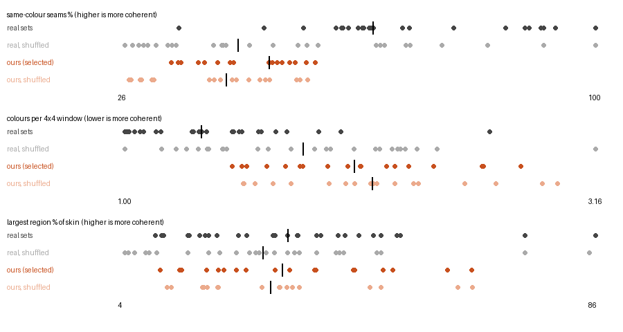

# M12c: colour coherence of our builds vs the real sets (measured, nothing built)

**Question.** cf's read is that the complete chair is a colour mottle. How far are our selected builds' visible
colours from the real sets', and how much of that is the builder's colour choice rather than the parts it placed?

**Answer.** Our builds are less colour-coherent than their own set on both metrics that tell real sets apart, on all 18
pairs. The builder's colouring is close to random given its part placement.

| metric | ours, median | own set | gap, median (range) |
|---|---:|---:|---:|
| same-colour visible seams | 49% | 64–71% | −22 points (−8 to −31) |
| colours per 4 × 4 skin window | 2.05 | 1.09–1.50 | +0.73 (+0.15 to +1.33) |

- **Close to random.** Shuffling our colours among parts of the same type changes the seam metric by only 1–11 points
  (median 5). Real sets beat their own shuffle by a median 21 points: their colours are placed, ours mostly are not.
- **Third metric.** The largest one-colour region does not separate real from ours, or either from its shuffle
  (medians 33 / 32%). It reflects how much of the colour supply sits in one colour, not how colours are placed. It is
  reported, but it is not a criterion.
- **Complete chair.** The complete 5891-1 chair (creserve80, seed 1) is among the least coherent: 32% same-colour
  seams (its set 65%) and 2.23 colours per window (1.50).

## Metrics

`bricks/coherence.py` measures on the skin of `bricks/skin.py`: every cell face open to the outside, without the ground
layer's bottom faces. Colours are exact LDraw colours.
- **Same-colour seams:** a visible pair is two different parts whose skin faces lie side by side on one face plane, a
  seam the eye sees. The metric is the share of those pairs whose two parts share a colour. Each pair counts once,
  whatever the seam's length.
- **Colours per window:** the mean number of distinct colours in every 4 × 4 window of skin that is skin everywhere,
  on top planes and side planes. This is the skins measurement's window (`m12b_skins_measure.md`) with colours instead
  of parts.
- **Largest region:** the largest face-connected set of one-colour skin cells, as a share of all skin cells.
- **Shuffled:** colours permuted among the parts of each part type. This keeps every placement and every
  (part, colour) count, so it is exactly the space a recolouring pass could search. The value is the mean of 5 seeded
  draws.

## Method

`python -m brickwfc.experiments.coherence` generates nothing.
- **Real sets:** the 28 sets of `sets_selection.json`, voxelized with the full catalog as in the skins measurement.
  Faces next to non-catalog parts count as skin, the same caveat as there.
- **Our builds:** the selected build of each creserve and creserve80 run on the 9 sweep pairs, using the seed in its
  stats.json, plus the complete chair.
- **References:** each build is compared with the real model of its own set, which has the same colours, and with the
  median of the 28 sets. The largest region depends on size, so it also gets the median of the 5 real sets nearest in
  skin cells.

The size question for the other two metrics:
- Both are rates, not counts.
- Our builds have 866–2558 skin cells. The real sets of that size, 6378-1 included, sit at 48–94% seams and 1.01–1.99
  colours per window. Our builds are at 33–56% and 1.49–2.82.

## Result

Each cell is ours / ours shuffled / own set / 28-set median.

| build | parts | skin cells | colours on skin | same-colour seams % | colours per 4x4 window | largest region % of skin | largest region, 5 nearest in size |
|---|---:|---:|---:|---|---|---|---:|
| chair 6378-1, creserve | 182 | 985 | 9 | 48 / 43 / 71 / 65 | 2.31 / 2.35 / 1.09 / 1.35 | 33 / 31 / 17 / 33 | 41 |
| chair 5891-1, creserve | 337 | 1934 | 13 | 38 / 28 / 65 / 65 | 1.93 / 2.14 / 1.50 / 1.35 | 44 / 28 / 34 / 33 | 38 |
| chair 4956-1, creserve | 390 | 2558 | 12 | 54 / 53 / 64 / 65 | 1.54 / 1.60 / 1.34 / 1.35 | 51 / 47 / 34 / 33 | 38 |
| table 6378-1, creserve | 200 | 1225 | 9 | 51 / 41 / 71 / 65 | 1.81 / 2.02 / 1.09 / 1.35 | 10 / 11 / 17 / 33 | 33 |
| table 5891-1, creserve | 333 | 1722 | 13 | 37 / 26 / 65 / 65 | 2.64 / 2.92 / 1.50 / 1.35 | 24 / 18 / 34 / 33 | 30 |
| table 4956-1, creserve | 426 | 2494 | 12 | 50 / 47 / 64 / 65 | 1.74 / 1.76 / 1.34 / 1.35 | 18 / 18 / 34 / 33 | 38 |
| car 6378-1, creserve | 196 | 1040 | 8 | 42 / 39 / 71 / 65 | 2.03 / 2.13 / 1.09 / 1.35 | 30 / 32 / 17 / 33 | 41 |
| car 5891-1, creserve | 338 | 1648 | 13 | 34 / 28 / 65 / 65 | 2.24 / 2.33 / 1.50 / 1.35 | 37 / 31 / 34 / 33 | 30 |
| car 4956-1, creserve | 412 | 2511 | 11 | 52 / 49 / 64 / 65 | 1.49 / 1.54 / 1.34 / 1.35 | 65 / 65 / 34 / 33 | 38 |
| chair 6378-1, creserve80 | 169 | 900 | 9 | 43 / 40 / 71 / 65 | 2.42 / 2.56 / 1.09 / 1.35 | 38 / 35 / 17 / 33 | 41 |
| chair 5891-1, creserve80 | 295 | 1671 | 13 | 40 / 30 / 65 / 65 | 2.09 / 2.24 / 1.50 / 1.35 | 25 / 18 / 34 / 33 | 30 |
| chair 4956-1, creserve80 | 358 | 2241 | 12 | 56 / 55 / 64 / 65 | 1.56 / 1.55 / 1.34 / 1.35 | 49 / 49 / 34 / 33 | 38 |
| table 6378-1, creserve80 | 184 | 866 | 9 | 49 / 43 / 71 / 65 | 2.20 / 2.16 / 1.09 / 1.35 | 14 / 20 / 17 / 33 | 43 |
| table 5891-1, creserve80 | 334 | 1427 | 13 | 35 / 30 / 65 / 65 | 2.82 / 2.99 / 1.50 / 1.35 | 14 / 19 / 34 / 33 | 30 |
| table 4956-1, creserve80 | 327 | 2025 | 12 | 56 / 53 / 64 / 65 | 1.82 / 1.94 / 1.34 / 1.35 | 20 / 20 / 34 / 33 | 38 |
| car 6378-1, creserve80 | 181 | 887 | 9 | 53 / 45 / 71 / 65 | 2.08 / 2.06 / 1.09 / 1.35 | 44 / 33 / 17 / 33 | 41 |
| car 5891-1, creserve80 | 318 | 1460 | 13 | 33 / 27 / 65 / 65 | 2.65 / 2.71 / 1.50 / 1.35 | 21 / 12 / 34 / 33 | 30 |
| car 4956-1, creserve80 | 375 | 1981 | 12 | 49 / 48 / 64 / 65 | 1.65 / 1.68 / 1.34 / 1.35 | 60 / 62 / 34 / 33 | 38 |
| chair 5891-1, creserve80, seed 1 (complete) | 292 | 1687 | 13 | 32 / 27 / 65 / 65 | 2.23 / 2.40 / 1.50 / 1.35 | 22 / 23 / 34 / 33 | 30 |

`m12c_colour_measure.json` has the 28 real sets' rows, each with its shuffle.

## Reading

- **The gap is colour placement, not colour supply.**
  - Our builds show more colours on their skin than the real set they come from: 6378-1 shows 6 colours, ours 8–9;
    5891-1 shows 11, ours 13; 4956-1 shows 9, ours 11–12. The real models keep their odd colours inside or use them
    sparingly; ours put them on the surface as often as anywhere.
  - Within a part type, our colours are close to random: ours beat their own shuffle by 1–11 seam points, real sets
    by up to 37, median 21.
- **4956-1 is the exception.** The real model is no more coherent than its within-type shuffle (64 vs 66). Its
  coherence comes from which part types go where, not from which copy of a type carries which colour. Ours is 8–15
  points below it there. A within-type recolouring would have to beat random by more than the real model does to
  close that gap.

## The cheapest lever, and its cost (not built)

**Recolouring post-pass (cheapest).** After generation, permute colours among parts of the same type, which is exactly
the space `coherence.shuffled` samples. The search would favour same-colour visible seams and few colours per window,
and push off-colours onto parts that show no face.
- **Guarantees, by construction:** every placement stays, so validity, support, physics, one piece and completeness are
  unchanged. Every (part, colour) count stays, so the build still fits the inventory. No guarantee needs re-checking.
- **The reservoir:** interior parts show no face, so they are free slots for the colours the surface should not show.
  Our builds show 2–3 colours more than their set does.
- **Cost:**
  - **Code:** a small module, a local swap search (greedy or annealing over same-type swaps; about 200–430 parts per
    build, each swap re-scored on its neighbours), seconds per build, plus tests. It needs no reruns: it can be
    applied to every cached candidate.
  - **The judge:** the judge's colour term reads same-colour contact rates, so recolouring changes judge scores. Run
    it before the judge (so selection sees the colours) or after select (so the judge stays as measured). Re-ranking
    the cached sweeps would tell which.
- **Unknown until built:** how far an optimised permutation gets above random (the headroom). It is limited where a
  part type comes in one colour only, or where coherence depends on type placement (4956-1). Measuring that headroom
  on the 18 cached builds is the first step if this is taken up.

**Decode-time colour term (dearer).** Add a colour-coherence factor to `StyleBias` or the proposal for parts on
exposed cells, conditioned on the colours of exposed neighbours.
- **Cost:** it changes generation, so every sweep must be rerun (hours) and completeness re-measured. Colour and part
  choices are joint (`styled_tileset`), so it also shifts part choices.
- **Weakness:** with fixed colour counts, late placements are forced into whatever colours are left, which is the
  mottle again, with nothing that controls it.
- **Verdict:** worth it only if the post-pass's headroom proves too small.

## Reproduce

See `docs/reproduce.md` (§ `results/m12c_colour_measure.md`).
