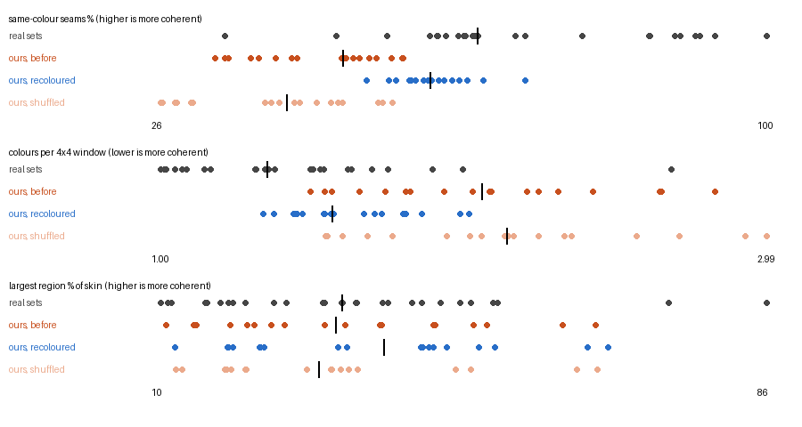
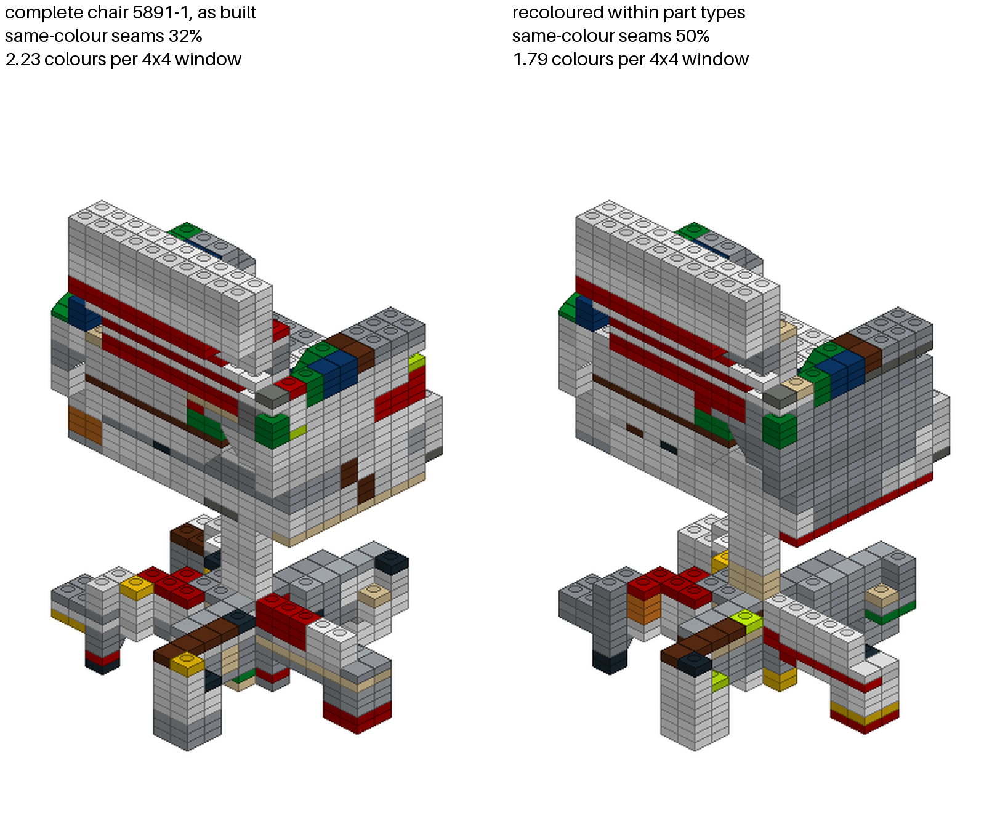

# M12c: recolouring within part types (`--recolor`), on the cached selections

**Question.** `m12c_colour_measure.md` found our builds' colours close to random within each part type and 8–31 points
below their own set on same-colour seams. How much does a recolouring that keeps every placement and every
(part, colour) count recover?

**Answer.** Most of the gap.

| metric | median gain | gap to own set, before → after | pairs that now match the own set |
|---|---|---|---:|
| same-colour visible seams | +16 points (+7 to +25) | −22 → −7 points | 2 |
| colours per 4 × 4 skin window | −0.49 (−0.10 to −0.81) | +0.73 → +0.35 | 1 |

- **Every build improves**, on all 18 pairs, in 1.3–4 s each.
- **Recoloured builds beat random.** Ours now sit 9–29 seam points above their own random within-type shuffle, a
  median 21. Before, they sat 1–11 points above it; the real sets are a median 21 above theirs.
- **The 4956-1 pairs gain least** (+7 to +10 seam points). 68–76% of their skin is on part types that come in one
  colour in the build, which no recolouring can change. Their gap to the own set was already the smallest, and is
  now −8 to +1.
- **The complete chair** goes from 32% to 50% same-colour seams and from 2.23 to 1.79 colours per window
  (`m12c_recolour_chair.png`).

## What it does

`bricks/recolor.py` searches the space `coherence.shuffled` samples: a permutation of colours among the parts of each
part type.
- **Guarantees, by construction:** every placement stays, so validity, support, physics, one piece and completeness
  are unchanged. Every (part, colour) count stays, so the inventory still fits.
- **Interior parts are the reservoir:** a part with no skin face can take an off-colour out of sight.

**Score:** same-colour share of the visible part pairs − 0.25 × mean distinct colours per full 4 × 4 skin window. A
drop of one colour per window is worth 25 seam points. The measured gap to the real sets (22 points and 0.73 colours)
weighs the two terms about equally.

**Search:** simulated annealing.
- **Proposal:** take a visible part whose type comes in more than one colour, and swap colours with a part of its type
  that has another colour, visible or not.
- **Budget:** 1000 proposals per such part, which is 9 000–37 000 accepted swaps per build here.
- **Temperature:** falls linearly from one seam's share to 0, and the best colouring seen is returned. Each proposal is
  scored incrementally from the pairs and windows of the two parts.
- **Why not plain hill climbing:** it stops 2–3 seam points lower in a local optimum. On a synthetic slab, the
  "halves" colouring is two swaps away from the optimum, and only annealing with best-seen tracking finds the optimum
  on every seed.
- **Determinism:** the search uses the Generator [build seed, 7].

**In the pipeline:** `--recolor` (`AltConfig.recolor`, default off) runs after select, on the selected builds only.
- **What is unchanged:** the judge, the selection and the cached candidates are those of the builds as generated, and
  the `judge` in stats.json is the original build's.
- **What is written:** the written builds and previews are recoloured. Each stats.json row gains `recolor`: seams and
  colours per window before and after, swaps, the fixed skin share and seconds.
- **The alternative:** recolouring every candidate before the judge. The judge's colour term (same-colour contact
  rates) would then see the new colours, and the selection could change. That costs about 3 s × 50 candidates per
  run, and it was not measured.

## Result

Same-colour seams and colours per window are given as before / after / shuffled / own set. "Fixed skin %" is the
share of skin cells on part types that come in one colour in the build. "Above the shuffle" is the seam points above
the build's own random within-type shuffle, before / after.

| build | fixed skin % | same-colour seams % | colours per 4x4 window | above the shuffle | s |
|---|---:|---|---|---|---:|
| chair 6378-1, creserve | 32 | 48 / 60 / 43 / 71 | 2.31 / 1.81 / 2.35 / 1.09 | +6 / +18 | 2.1 |
| chair 5891-1, creserve | 20 | 38 / 57 / 28 / 65 | 1.93 / 1.54 / 2.14 / 1.50 | +10 / +29 | 4.0 |
| chair 4956-1, creserve | 68 | 54 / 64 / 53 / 64 | 1.54 / 1.44 / 1.60 / 1.34 | +2 / +11 | 2.5 |
| table 6378-1, creserve | 33 | 51 / 66 / 41 / 71 | 1.81 / 1.45 / 2.02 / 1.09 | +10 / +25 | 1.8 |
| table 5891-1, creserve | 26 | 37 / 55 / 26 / 65 | 2.64 / 1.86 / 2.92 / 1.50 | +11 / +29 | 3.5 |
| table 4956-1, creserve | 72 | 50 / 58 / 47 / 64 | 1.74 / 1.57 / 1.76 / 1.34 | +3 / +11 | 2.7 |
| car 6378-1, creserve | 18 | 42 / 59 / 39 / 71 | 2.03 / 1.44 / 2.13 / 1.09 | +3 / +20 | 1.6 |
| car 5891-1, creserve | 25 | 34 / 54 / 28 / 65 | 2.24 / 1.67 / 2.33 / 1.50 | +6 / +26 | 2.9 |
| car 4956-1, creserve | 71 | 52 / 59 / 49 / 64 | 1.49 / 1.37 / 1.54 / 1.34 | +3 / +10 | 2.3 |
| chair 6378-1, creserve80 | 36 | 43 / 61 / 40 / 71 | 2.42 / 1.80 / 2.56 / 1.09 | +3 / +21 | 1.7 |
| chair 5891-1, creserve80 | 21 | 40 / 57 / 30 / 65 | 2.09 / 1.56 / 2.24 / 1.50 | +10 / +27 | 2.9 |
| chair 4956-1, creserve80 | 76 | 56 / 66 / 55 / 64 | 1.56 / 1.34 / 1.55 / 1.34 | +1 / +11 | 1.8 |
| table 6378-1, creserve80 | 30 | 49 / 62 / 43 / 71 | 2.20 / 1.73 / 2.16 / 1.09 | +5 / +18 | 1.5 |
| table 5891-1, creserve80 | 23 | 35 / 59 / 30 / 65 | 2.82 / 2.02 / 2.99 / 1.50 | +4 / +29 | 3.1 |
| table 4956-1, creserve80 | 70 | 56 / 63 / 53 / 64 | 1.82 / 1.71 / 1.94 / 1.34 | +2 / +9 | 1.8 |
| car 6378-1, creserve80 | 34 | 53 / 71 / 45 / 71 | 2.08 / 1.54 / 2.06 / 1.09 | +7 / +25 | 1.3 |
| car 5891-1, creserve80 | 34 | 33 / 52 / 27 / 65 | 2.65 / 1.98 / 2.71 / 1.50 | +6 / +25 | 2.5 |
| car 4956-1, creserve80 | 74 | 49 / 57 / 48 / 64 | 1.65 / 1.47 / 1.68 / 1.34 | +1 / +9 | 2.0 |
| chair 5891-1, creserve80, seed 1 (complete) | 26 | 32 / 50 / 27 / 65 | 2.23 / 1.79 / 2.40 / 1.50 | +5 / +24 | 3.7 |

The largest one-colour region, not a criterion (`m12c_colour_measure.md`), rises from a median 32% to 38% of the
skin. The number of distinct colours on the skin is unchanged or one lower: the permutation keeps each type's colours,
and an off-colour leaves the skin only when an interior part of its type can take it.

## Reading

- **What is left:** a median 7 seam points and 0.35 colours per window to the own set. It has two parts.
  - **One-colour part types:** on 4956-1, 68–76% of the skin is fixed.
  - **Which part type goes where:** a permutation within types cannot move a colour onto another part type.
  - Both would take a step outside this space. One option is spare inventory: the builds use 64–92% of their parts,
    so the unused parts of a type are more colours to swap with, within the inventory's counts but changing the
    build's own. The other is a colour term at decode time.
- **Not measured:** whether the judge would rank the recoloured builds differently.

## Recommendation on the default

Turn `--recolor` on by default for runs with a target, after select as now, once Mac has looked at
`m12c_recolour_chair.png`.
- **What it costs:** 2–4 s per selected build and no guarantee, since it changes no placement or count.
- **What it gives:** a more coherent surface on 18 of 18 pairs.
- **What it does not touch:** the judge and the selection.
- **The open point:** whether the eye agrees with the metrics. That is Mac's call, so the flag stays off until then.

## Reproduce

See `docs/reproduce.md` (§ `results/m12c_recolour.md`).
